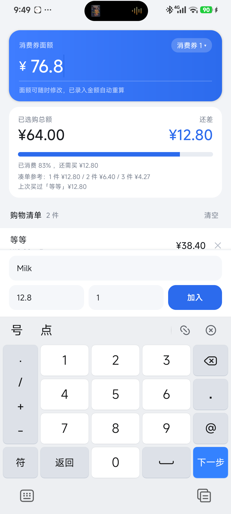

# 消费券计算器（CouponCalc）

一次性消费券的凑单计算工具。填入券面额，逐条录入商品（名称 / 单价 / 数量），实时显示**已选购总额**和**还差多少**才能用完券。

- 包名：`com.smhesinger.couponcalc`
- 当前版本：**v1.2.0**（versionCode 3）
- 支持：Android 5.0+（minSdk 21，targetSdk 34）
- 安装包：[Releases 下载 APK](https://github.com/Lynn-Singer/CouponCalc/releases)（98.7 KB，无第三方依赖、不联网、无权限）

<p align="center">
  
</p>

## 功能

### 基础

| 功能 | 说明 |
|---|---|
| 券面额 | 顶部蓝色卡片内直接输入/修改，改动后所有金额立即重算 |
| 录入商品 | 名称 + 单价 + 数量（数量支持小数，如 0.5 kg 称重商品） |
| 实时汇总 | 已选购总额、还差金额、进度条、百分比与剩余金额 |
| 状态反馈 | 未达标蓝色「还差」；刚好用完变绿；超出面额变红并提示需自付补差 |
| 逐条删除 | 每行右侧 ✕，金额同步回退 |
| 清空 | 清单标题右侧「清空」，二次确认，只清当前券 |
| 自动保存 | 全部数据本地存储，杀进程/重启后仍在 |

### v1.1.0 新增

**1. 点行编辑**
点清单里任意一行，弹出「修改商品」对话框，可改名称 / 单价 / 数量。输入不合法时提示并且**对话框不会关闭**，改对为止。对话框里还有「删除」按钮。

**2. 商品名联想 + 自动带价**
底部名称框输入任意字，会从历史商品里联想（前缀匹配优先，其次包含匹配 —— 输入「牛奶」也能搜到「伊利纯牛奶」）。点选建议项后**自动填入上次的单价**，只需再改数量，录得快。

**3. 多张消费券，各自独立清单**
券卡右上角胶囊按钮（显示当前券名）→ 弹出券列表：
- 点击 = 切换券（每张券有独立面额和独立清单）
- 长按 = 重命名
- 「新建」= 加一张券（自动命名 消费券 N，可改名）
- 「删除当前」= 删除该券及其清单（至少保留一张）

**4. 凑单建议**
还没花完时，汇总卡底部多一行「凑单参考」：
- 差额均摊成 1 件 / 2 件 / 3 件的单价参考，例如 `1 件 ¥31.50 / 2 件 ¥15.75 / 3 件 ¥10.50`
- 若历史里买过单价接近差额的商品，额外提示 `上次买过「金龙鱼食用油」¥31.20`

### v1.2.0 新增：比价页

录入栏「加入」按钮正上方的「比价」按钮进入（同尺寸、右边缘对齐，浅蓝描边区分主次）。用来算**不同规格的商品哪个更合算** —— 500g 装和 1kg 装、250ml×12 和 1L 装、90 抽和 120 抽。

**先解决什么能和什么比**

500g 大米 ¥12.9 和 1.5L 牛奶 ¥19.9 折成单价后一个是元/斤、一个是元/L，两个数字没有可比性。所以按计量维度分组，**组内排名，跨组不排名**：

| 维度 | 支持单位 | 折算基准 |
|---|---|---|
| 重量 | g、kg、斤、两 | 元/斤（500g） |
| 容量 | ml、L | 元/L |
| 个数 | 个、片、包、抽、卷 | 元/个 |

重量统一用「元/斤」而不是元/kg，是买菜直觉；超市价签也基本写元/500g，两者等价。

**排名与提示**

- 组内按单价从低到高排，最低的卡片变绿并标「最划算」
- 其余的标「贵 x%」（相对组内最低价，不是绝对差额 —— 每斤贵 4 毛和贵 4 块，看百分比才知道量级）
- 差距小于 3% 时改标「基本持平」，不必为了几厘钱换规格

**按需购买（大包装不一定真省钱）**

点分组标题右侧「按需购买」，填你大概要买多少斤 / 升 / 个。排名依据立刻从「单价」切换成**实际总支出**（含买多了的部分）：

> 米价：10kg ¥89.90（4.50 元/斤）、1kg ¥12.90（6.45 元/斤）
> 如果只要 2kg = 4 斤，买 1 袋 10kg 要花 ¥89.90，买 2 袋 1kg 只要 ¥25.80

这时「最划算」会变成「最省钱」，徽标也改说「多花 x%」，两种口径不混用。

**其他**

- 可无限追加：第 3 条、第 4 条、第 N 条都行，输入区固定在顶部不用来回滚
- 单位下拉 11 种，选错直接改，结果实时重算
- 点某条可「加入凑单购物车」，名称和单价自动带进当前券的清单
- 比价清单独立存储（`compare_v1`），与凑单数据互不影响

## 使用流程

1. 打开 App，在顶部「消费券面额」填 100 / 200 / 任意金额。
2. 底部录入栏填商品名称（打过一次的字会自动联想）、单价、数量，点「加入」。
3. 看中间汇总卡：已选购总额 + 右上「还差 ¥xx.xx」+ 底部凑单参考。
4. 加够为止 —— 进度条满且变绿说明刚好用完券；变红说明超了。
5. 多张券（比如中秋券、年货券）用券卡右上角的胶囊按钮切换或新建。

## 构建

**不需要 Gradle**，走 `aapt2 → javac → d8 → zipalign → apksigner` 手写链路，出包约 30 秒，全程可离线。

需要准备：

| 依赖 | 要求 |
|---|---|
| JDK | 17（提供 `javac` / `keytool`） |
| Android SDK | 含 `build-tools`（36 已测）与任一 `platforms/android-*` |
| Python | 3.8+ |

告诉脚本 SDK 在哪（三选一，按顺序探测）：

```bash
set ANDROID_SDK=D:\Android\Sdk     # Windows
export ANDROID_SDK=~/Android/Sdk   # macOS / Linux
```

三者都不设时，会依次尝试 `ANDROID_HOME`、`ANDROID_SDK_ROOT`、`%LOCALAPPDATA%\Android\Sdk`、`~/AppData/Local/Android/Sdk`、`~/Android/Sdk`、`~/Library/Android/sdk`。`build-tools` 与 `platforms` 目录下取版本号最大的那个，不用手改路径。

```bash
python tools/build.py                                    # 出包 out/CouponCalc-v1.1.0.apk
adb install -r out/CouponCalc-v1.1.0.apk
```

首次构建会自动生成 `debug.keystore`（`tools/build.py` 里 `keytool -genkeypair`），所以 `out/` 与 `.keystore/` 都不进版本库。注意这个 debug 签名只能自己装，**上架应用商店需要换成正式 keystore**。

改版本号要同步两处：`app/AndroidManifest.xml` 的 versionCode/versionName + `tools/build.py` 的 VERSION。

## 目录结构

```
app/
  AndroidManifest.xml
  java/com/smhesinger/couponcalc/
    MainActivity.java   界面与交互（录入、汇总、编辑、切券、凑单建议）
    CompareActivity.java 比价页（分组排名、按需成本、带入购物车）
    Store.java          本地存储（多券 + 历史商品，含 v1.0 数据自动迁移）
    Coupon.java         一张券 = 面额 + 清单
    Item.java           单条商品（单价 × 数量）
    History.java        历史商品（名称 + 最近单价）
    Unit.java           计量单位与折算（重量/容量/个数 → 元/斤、元/L、元/个）
    Spec.java           一条比价项（规格 × 单位 → 单价、按需成本）
    NameAdapter.java    名称联想适配器（自定义 Filterable，前缀优先）
    ItemAdapter.java    清单列表适配器（点击编辑、✕ 删除）
    SpecAdapter.java    比价结果适配器（分组、排名、徽标配色）
    Fmt.java            金额/数量格式化与输入解析
  res/
    layout/activity_main.xml     主界面
    layout/activity_compare.xml  比价页
    layout/item_row.xml          清单行
    layout/item_spec.xml         比价结果行
    layout/dialog_edit_item.xml  修改商品对话框
    drawable/                    卡片、输入框、主/次按钮、进度条、券切换胶囊
    values/                      颜色、主题、文案
    mipmap-*/                    启动图标（各密度 + Android 8+ 自适应图标）
tools/
  build.py      一键构建 APK（aapt2 → javac → d8 → zipalign → apksigner）
  make_icon.py  重新生成图标
  ui.py         真机自动化：按控件 id 点按、输入、截图、dump（调试用）
  test/         比价核心算法的离线自测（纯 Java，不依赖 Android）
shots/          真机截图
out/            构建产物
```

## 想改什么，改哪里

| 需求 | 位置 |
|---|---|
| 改配色（主色/警示色） | `app/res/values/colors.xml` |
| 改文案、提示语 | 布局 xml 与 `MainActivity.java` |
| 改 App 名称 | `app/res/values/strings.xml` |
| 联想规则（前缀/包含/模糊） | `NameAdapter.java` 的 `performFiltering` |
| 凑单建议算法 | `MainActivity.showSuggest` + `Store.closestTo` |
| 比价折算基准（元/斤 vs 元/kg） | `Unit.baseSize` + `Unit.priceLabel` |
| 单位清单（加「米」「克」等） | `Unit.CODES` / `DIMS` / `TO_BASE` 三处同步 |
| 「持平」阈值（现为 3%） | `CompareActivity.TIE_PCT` |
| 按需成本的取整规则 | `Spec.packsFor` |
| 加字段（如分类、备注） | `Item.java` → `item_row.xml` → `Store` 序列化 → 编辑对话框 |

## 已知取舍

- 金额用 double 累加后四舍五入到分显示，超市小票级精度足够。
- 名称联想存最近 80 个商品名，超出淘汰最久未用的。
- 券的删除只保留"至少一张"，没有回收站；删券前会二次确认。
- 历史商品库目前不区分券，所有券共用一份联想库（同一超市场景更实用）。
- 比价不做跨维度换算：1kg 洗衣液和 2L 洗衣液要知密度才能比，App 不猜这个。
- 组合装（200ml×24）目前需自己算总量填 4800ml，没有「×件数」输入框。
- 按需成本按整件向上取整，不考虑家里已有的余量。
- 比价清单与凑单清单各自独立存储，不自动同步（只能手动「加入购物车」带过去）。
